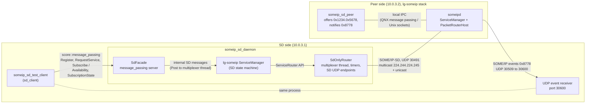

<!--
*******************************************************************************
Copyright (c) 2026 Contributors to the Eclipse Foundation

See the NOTICE file(s) distributed with this work for additional
information regarding copyright ownership.

This program and the accompanying materials are made available under the
terms of the Apache License Version 2.0 which is available at
https://www.apache.org/licenses/LICENSE-2.0

SPDX-License-Identifier: Apache-2.0
*******************************************************************************
-->

# Experimental SOME/IP service discovery prototype

SOME/IP-SD only daemon based on the `ServiceManager` of [lg-someip](https://github.com/LGE-OSS/lg-someip),
exposed to local clients via `score::message_passing`. Not part of the product.

| Target | Description |
| --- | --- |
| `:someip_sd_daemon` | SD-only daemon (lg-someip `ServiceManager` with an injected `SdOnlyRouter`) |
| `:sd_client` | Client library for the daemon protocol (`protocol/sd_protocol.h`) |
| `:someip_sd_test_client` | Requests a service, subscribes an eventgroup and prints received events |
| `test:someip_sd_peer` | Remote provider on the upstream lg-someip stack, offers `0x1234/0x5678` continuously |
| `@lg_someip//:someipd` | Upstream lg-someip routing daemon, required by `test:someip_sd_peer` |
| `test:someip_sd_dual_qemu_test` | Integration test on two QNX QEMU VMs (see below) |
| `test:someip_sd_docker_test` | Same integration test on two Linux Docker containers |

## Architecture (stage 1)



- The daemon only does service discovery. `ServiceManager` runs unchanged; `SdOnlyRouter` replaces lg-someip's
  `PacketRouterHost`, sends and receives the SD messages and serializes all `ServiceManager` calls on its
  multiplexer thread.
- `add_route` / `add_subscribe_route` calls from the `ServiceManager` are only logged. They are the hook for the
  later event module; in stage 1 the test client receives the events directly on its own UDP port.
- Clients talk to the daemon via `score::message_passing` with the fixed-size messages in
  [protocol/sd_protocol.h](protocol/sd_protocol.h); each connection gets a client id that is used as lg-someip
  application id.

## Integration tests

```sh
bazel test //experimental/someip_sd/test:someip_sd_docker_test                            # Linux
bazel test --config=qnx_x86_64 //experimental/someip_sd/test:someip_sd_dual_qemu_test     # QNX
```

Both run the scenario in [test/someip_sd_scenario.py](test/someip_sd_scenario.py) with the configs in
[test/config](test/config): the SD side (10.0.3.1) runs `someip_sd_daemon` and the test client, the peer side (10.0.3.2) runs
`someipd` and `someip_sd_peer`. The test checks availability, subscription acknowledgement and received events.

- QNX: `dual_qemu` environment with the inter-VM network. Requires the QNX toolchain setup described in the root
  `.bazelrc`.
- Linux: the ITF Docker container plus a second container started by the test, both attached to a bridge network
  with subnet 10.0.3.0/24 (must not be in use on the host).

## Configuration

[test/config](test/config) holds the lg-someip configurations of both sides; the integration tests use them unchanged.

- SD uses port 30491 instead of the standard 30490, so the prototype can run next to an existing SOME/IP stack
  (e.g. `someipd_posix` on the target). Both configurations must use the same SD port and multicast group.
- `unicast` is 10.0.3.1 (SD side) and 10.0.3.2 (peer side), the addresses of the test networks.

## lg-someip

Fetched as `@lg_someip` (see `MODULE.bazel`) with the build file and patch in
[third_party/lg_someip](../../third_party/lg_someip). The build follows the upstream CMake defaults, i.e. on QNX
local IPC and the `ServiceManager` timer use QNX message passing (`ENABLE_QNX_MESSAGE_PASSING`); `SdOnlyRouter`
implements the corresponding timer callbacks.

| Target | Used by |
| --- | --- |
| `@lg_someip//:lgsomeip` | `someip_sd_peer` |
| `@lg_someip//:daemon_core` (`ServiceManager`, `PacketRouterHost`) | `someip_sd_daemon` (injects `SdOnlyRouter`), `someipd` |

`0001-fix-subscribe-ack-multicast-reset.patch` fixes a no-op `multicast == nullptr` in `ServiceManager`, so a
SubscribeEventgroupAck with a unicast endpoint option is no longer treated as multicast (candidate for an upstream
fix). The QNX 8 build issues (`SO_VLANPRIO`, `__progname`) are fixed upstream since `d09656e`.

## Running on a target

Build for the target, copy `someip_sd_daemon`, `someip_sd_test_client` and `test/config/sd_daemon.json` to the target
and set `unicast` to the target's address on the interface towards the peer. Daemon and test client must run on
the same machine, they talk via `score::message_passing`.

```sh
./someip_sd_daemon sd_daemon.json
./someip_sd_test_client --service 0x1234 --instance 0x5678 --eventgroup 0x4465 --event-port 30600
```

The peer side (`someipd` and `someip_sd_peer` with `test/config/lg_peer.json`, `unicast` set accordingly) runs on another
machine in the same subnet; start `someipd` first, the provider registers with it.

Expected test client output: the service becomes available, the subscription is acknowledged and event `0x8778`
arrives every second with an incrementing counter as payload.
