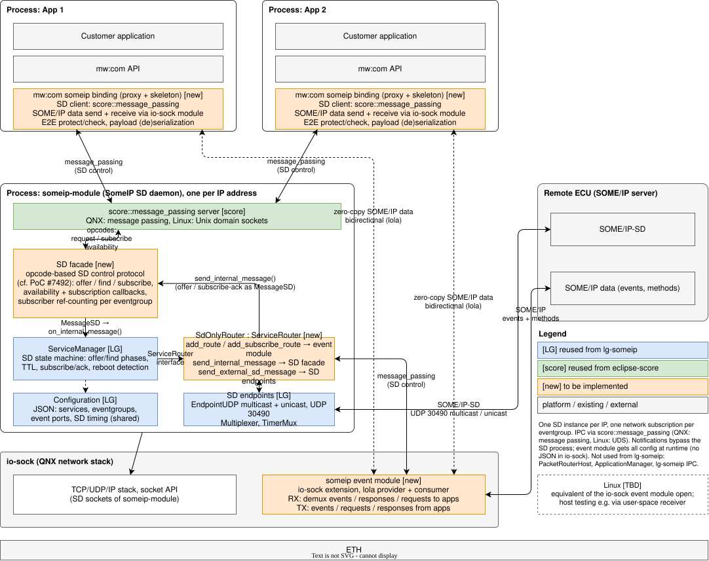
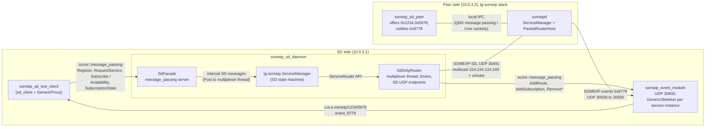
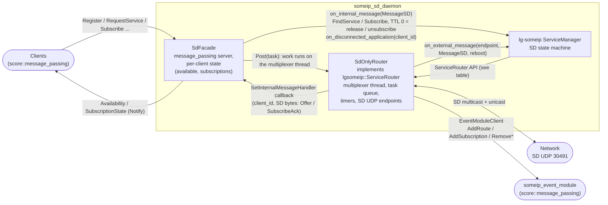

<!--
*******************************************************************************
Copyright (c) 2026 Contributors to the Eclipse Foundation

See the NOTICE file(s) distributed with this work for additional
information regarding copyright ownership.

This program and the accompanying materials are made available under the
terms of the Apache License Version 2.0 which is available at
https://www.apache.org/licenses/LICENSE-2.0

SPDX-License-Identifier: Apache-2.0
*******************************************************************************
-->

# Experimental SOME/IP service discovery prototype

SOME/IP-SD only daemon based on the `ServiceManager` of [lg-someip](https://github.com/LGE-OSS/lg-someip),
exposed to local clients via `score::message_passing`. Not part of the product.

| Target | Description |
| --- | --- |
| `:someip_sd_daemon` | SD-only daemon (lg-someip `ServiceManager` with an injected `SdOnlyRouter`) |
| `:someip_event_module` | User-space stand-in for the io-sock event module: SOME/IP notifications (UDP) to LoLa events |
| `:sd_client` | Client library for the daemon protocol (`protocol/sd_protocol.h`) |
| `:someip_sd_test_client` | Requests a service, subscribes an eventgroup and prints the events received via LoLa |
| `test:someip_sd_peer` | Remote provider on the upstream lg-someip stack, offers `0x1234/0x5678` continuously |
| `@lg_someip//:someipd` | Upstream lg-someip routing daemon, required by `test:someip_sd_peer` |
| `test:someip_sd_dual_qemu_test` | Integration test on two QNX QEMU VMs (see below) |
| `test:someip_sd_docker_test` | Same integration test on two Linux Docker containers |

## Prototyp target architecture overview


## Architecture (stage 2)



- The daemon only does service discovery. `ServiceManager` runs unchanged; `SdOnlyRouter` replaces lg-someip's
  `PacketRouterHost`, sends and receives the SD messages and serializes all `ServiceManager` calls on its
  multiplexer thread.
- Clients talk to the daemon via `score::message_passing` with the fixed-size messages in
  [protocol/sd_protocol.h](protocol/sd_protocol.h); each connection gets a client id that is used as lg-someip
  application id.
- `SdOnlyRouter` forwards the `ServiceManager` routing callbacks to the event module
  ([protocol/event_module_protocol.h](protocol/event_module_protocol.h)):
  - `add_route` / `remove_route` (remote offer) become `AddRoute` / `RemoveRoute` with the local UDP port, the
    remote UDP endpoint and the events of the service from the lg-someip configuration.
  - `add_subscribe_route` / `remove_subscribe_route` for local clients (SubscribeAck received) become
    `AddSubscription` / `RemoveSubscription` per event.
- The event module offers one LoLa `GenericSkeleton` per SOME/IP service instance (`someip/<service>/<instance>`)
  with one event per SOME/IP event (`event_<event id>`) while the remote service is available, and forwards
  subscribed notifications. A sample (`EventSample`) carries the serialized payload with its length, session,
  interface version and message type; the payload is copied once from the socket into the LoLa slot.
- The LoLa deployment ([test/config/mw_com_config.json](test/config/mw_com_config.json)) must list every
  service instance and event the event module offers; it is shared by the event module and the consumers.
- Limitations: UDP and IPv4 only, no SOME/IP-TP, no multicast eventgroups, payload up to 1400 bytes, no resync
  after an event module restart (restart the SD daemon as well), skeletons are never recreated.

### Daemon internals



`ServiceManager` → `SdOnlyRouter` (`lgsomeip::ServiceRouter`):

| Group | Calls | `SdOnlyRouter` |
| --- | --- | --- |
| Lifecycle | `init`, `start`, `stop` | Sets up the network device, multiplexer, task pipe and SD sockets; starts/stops the multiplexer |
| Infrastructure | `get_multiplexer`, `get_service_discovery_{multicast,unicast}_endpoint`, `make_address` | Returns its own objects |
| Timers (QNX) | `message_passing_set_timer`, `message_passing_kill_timer` | One thread per timer; the handler runs on the multiplexer thread via `Post` |
| SD output | `send_external_sd_message` | Sends via the unicast endpoint (to the target address or the multicast group) |
| | `send_internal_message` | Passed to the `InternalMessageHandler`, i.e. to `SdFacade` |
| Data routing | `add_route`, `remove_route` | Forwarded to the event module as `AddRoute` / `RemoveRoute` (IPv4 UDP endpoint, local port, configured events) |
| | `find_connection` | Always returns 1 (no TCP yet) |
| | `add_subscribe_route`, `remove_subscribe_route` | For local clients forwarded as `AddSubscription` / `RemoveSubscription` per event; remote and multicast routes are only logged |
| Other | `set_instance_id`, `check_and_send_magic_cookies`, `reboot_route` | No-op / logged |

Calls into `ServiceManager`:

| Caller | Call | Purpose |
| --- | --- | --- |
| `SdOnlyRouter` | `on_external_message(endpoint, sd, reboot)` | SD message received from the network, filtered (own sender, port) and checked for reboot |
| `SdFacade` | `on_internal_message(sd)` | Client request as internal SD message; the client id is put into the client part of the request id |
| `SdFacade` | `on_disconnected_application(client_id)` | Cleanup after a client disconnected |
| `main` | constructor `(name, config, router)`, `init`, `start`, `stop`, `get_configuration` | Lifecycle |

Threading:

- `SdFacade`'s message_passing callbacks never call the `ServiceManager` directly but `Post` to the multiplexer
  thread, so all `ServiceManager` calls are serialized there, like in lg-someip's own daemon.
- `send_internal_message` is called synchronously from within the `ServiceManager`; `SdFacade` posts it again, so
  `HandleServiceManagerMessage` does not run re-entrantly inside the `ServiceManager`.
- Exception: the `ServiceManager` calls `add_route` from its own worker thread (`SomeipSvcConn`).

## Integration tests

```sh
bazel test //experimental/someip_sd/test:someip_sd_docker_test                            # Linux
bazel test --config=qnx_x86_64 //experimental/someip_sd/test:someip_sd_dual_qemu_test     # QNX
```

Both run the scenario in [test/someip_sd_scenario.py](test/someip_sd_scenario.py) with the configs in
[test/config](test/config): the SD side (10.0.3.1) runs `someip_event_module`, `someip_sd_daemon` and the test client,
the peer side (10.0.3.2) runs `someipd` and `someip_sd_peer`. The test checks availability, subscription
acknowledgement, the LoLa offer of the event module, the events received via LoLa and that no events arrive after the
client unsubscribed (`--runtime`).

- QNX: `dual_qemu` environment with the inter-VM network. Requires the QNX toolchain setup described in the root
  `.bazelrc`.
- Linux: the ITF Docker container plus a second container started by the test, both attached to a bridge network
  with subnet 10.0.3.0/24 (must not be in use on the host).

## Configuration

[test/config](test/config) holds the lg-someip configurations of both sides and the mw::com configuration
(`mw_com_config.json`, `logging.json`) of the SD side; the integration tests use them unchanged.

- SD uses port 30491 instead of the standard 30490, so the prototype can run next to an existing SOME/IP stack
  (e.g. `someipd_posix` on the target). Both configurations must use the same SD port and multicast group.
- `unicast` is 10.0.3.1 (SD side) and 10.0.3.2 (peer side), the addresses of the test networks.

## lg-someip

Fetched as `@lg_someip` (see `MODULE.bazel`) with the build file and patch in
[third_party/lg_someip](../../third_party/lg_someip). The build follows the upstream CMake defaults, i.e. on QNX
local IPC and the `ServiceManager` timer use QNX message passing (`ENABLE_QNX_MESSAGE_PASSING`); `SdOnlyRouter`
implements the corresponding timer callbacks.

| Target | Used by |
| --- | --- |
| `@lg_someip//:lgsomeip` | `someip_sd_peer` |
| `@lg_someip//:daemon_core` (`ServiceManager`, `PacketRouterHost`) | `someip_sd_daemon` (injects `SdOnlyRouter`), `someipd` |

`0001-fix-subscribe-ack-multicast-reset.patch` fixes a no-op `multicast == nullptr` in `ServiceManager`, so a
SubscribeEventgroupAck with a unicast endpoint option is no longer treated as multicast (candidate for an upstream
fix). The QNX 8 build issues (`SO_VLANPRIO`, `__progname`) are fixed upstream since `d09656e`.

## Running on a target

Build for the target, copy `someip_event_module`, `someip_sd_daemon`, `someip_sd_test_client` and
`test/config/{sd_daemon,mw_com_config,logging}.json` to the target (binaries in `bin/`, configs in `etc/`) and set
`unicast` to the target's address on the interface towards the peer. All three processes must run on the same
machine; start the event module first.

```sh
./bin/someip_event_module ./etc/mw_com_config.json
./bin/someip_sd_daemon ./etc/sd_daemon.json
./bin/someip_sd_test_client --service 0x1234 --instance 0x5678 --eventgroup 0x4465 --event 0x8778 \
    --mw-com-config ./etc/mw_com_config.json
```

The peer side (`someipd` and `someip_sd_peer` with `test/config/lg_peer.json`, `unicast` set accordingly) runs on another
machine in the same subnet; start `someipd` first, the provider registers with it.

Expected test client output: the service becomes available, the subscription is acknowledged, the LoLa service
`someip/1234/5678` is found and event `0x8778` arrives every second via LoLa with an incrementing counter as payload.
With `--runtime <seconds>` the client unsubscribes afterwards, checks for 3 s that no further events arrive
(`result: OK, no events after unsubscribe`) and exits with 0; without it, it runs until SIGINT/SIGTERM.
